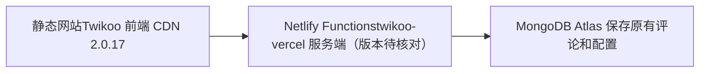

本站是jekyll部署在github pages上面的。选择twikoo作为评论系统的原因之前有说明：

[又又又换了博客的评论系统，也把软路由从R2S换成了R4S](https://www.zahui.top/posts/2025/03/28/new-comments.html)

今天在foreverblog看到文章在推荐twikoo，并且twioo已经升级到v2.0.17，我的版本还停留在1.6.4的版本。
所以做了一下升级，升级遇到了一些问题，通过chatgpt的提示已经完成了，简单做个总结：

### # 注意前端引入代码的准确性

```
<!-- Twikoo 评论容器 -->
<div id="tcomment"></div>

<!-- 引入 Twikoo 2.0.17 -->
<script src="https://s4.zstatic.net/npm/twikoo@2.0.17/dist/twikoo.min.js"></script>

<!-- 初始化 Twikoo -->
<script>
  twikoo.init({
    envId: 'https://zacom.netlify.app/.netlify/functions/twikoo',
    el: '#tcomment',
    lang: 'zh-CN'
  });
</script>
```

#### # 注意：升级 2.0.17 不只是替换 CDN

Twikoo 的官方升级文档明确要求：前端版本与云函数后端版本保持一致。
Twikoo 文档

你的架构是：

### # 按官方方式修复

#### 第一步：删除旧入口文件

在 Netlify 项目关联的代码仓库中，检查并删除：

netlify/functions/twikoo.js

但先确认其中没有你自己添加的定制业务逻辑。

#### 第二步：新建现代入口

创建 netlify/functions/twikoo.mjs，文件内容完整如下：

export { default } from "twikoo-netlify"

这是官方当前模板使用的入口代码。

#### 第三步：核对 package.json

官方模板的关键配置为：
```
{
  "dependencies": {
    "twikoo-netlify": "latest"
  },
  "engines": {
    "node": ">=22.12.0"
  }
}
```
如果你已有其他字段，请保留。首次修复可以参照官方模板，之后建议锁定验证过的具体依赖版本。

#### 第四步：确认 Node.js 版本

在仓库根目录建立 .node-version 文件，内容：

24

同时检查 Netlify 的 NODE_VERSION 环境变量是否覆盖了这个设置。

### 二、重新部署

进入
zacom Netlify 控制台 

Deploys → Trigger deploy → Clear cache and deploy site(这里非常关键netlify页面，trigger deploy下面有两个选项：deploy project和deploy project without cache，我们要选择第二个)

清理构建缓存非常重要，因为你已经从旧版更新了依赖和函数入口。

然后访问：

https://xxx.netlify.app/.netlify/functions/twikoo 

如果不再出现 D.handler is not a function，说明入口问题已经得到解决。再测试评论加载、提交及 CORS 响应。

正确的提示应该是：
```
{
  "code": 100,
  "message": "Twikoo 云函数运行正常，请参考 https://twikoo.js.org/frontend.html 完成前端的配置",
  "version": "2.0.17"
}
```

### 三、特别提醒：不要动 MongoDB

目前的错误发生在 Netlify Functions 的运行环节，尚无证据指向 MongoDB 数据损坏。

因此无需清空数据库、重新创建 MongoDB Cluster，也无需修改原有 MONGODB_URI。

